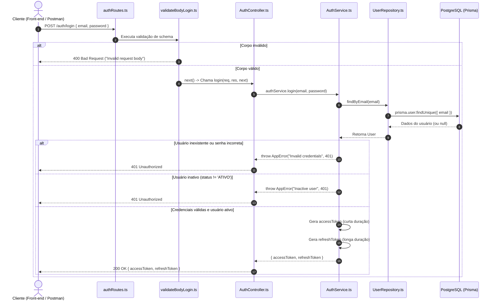
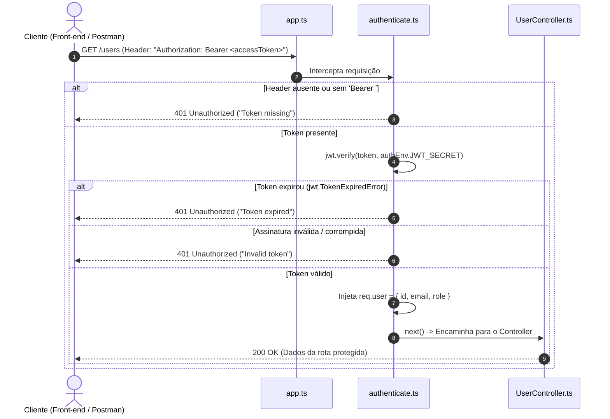
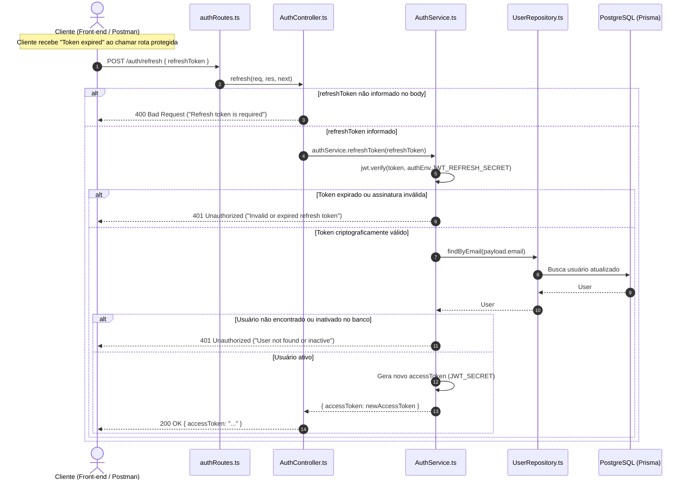

# Fluxo de Autenticação e Autorização (JWT & Refresh Token)

Este documento descreve detalhadamente a arquitetura e os fluxos de autenticação, acesso a rotas protegidas e renovação de tokens implementados na aplicação.

---

## 1. Visão Geral dos Componentes

| Camada / Arquivo | Responsabilidade |
| :--- | :--- |
| `src/routes/authRoutes.ts` | Declara os endpoints públicos `/auth/login` e `/auth/refresh`. |
| `src/middlewares/validateBodyLogin.ts` | Valida o payload de entrada da requisição de login com `loginSchema`. |
| `src/controllers/AuthController.ts` | Recebe os dados das requisições HTTP, chama as regras de negócio e retorna as respostas JSON. |
| `src/services/AuthService.ts` | Executa as regras de negócio: valida credenciais no banco, checa status do usuário, gera tokens e renova tokens. |
| `src/repositories/UserRepository.ts` | Comunicação com o PostgreSQL via Prisma para consultar e persistir usuários. |
| `src/middlewares/authenticate.ts` | Intercepta requisições protegidas, valida a assinatura do JWT e injeta os dados do usuário em `req.user`. |
| `src/types/express.d.ts` | Extensão de tipo do Express para suportar a propriedade `req.user` de forma estrita no TypeScript. |
| `src/schemas/auth.schema.ts` | Validação e tipagem das variáveis de ambiente (`JWT_SECRET`, `JWT_REFRESH_SECRET`, etc.). |

---

## 2. Fluxo 1: Login (`POST /auth/login`)

Realiza a autenticação inicial do usuário através de e-mail e senha, gerando o par de tokens (`accessToken` de curta duração e `refreshToken` de longa duração).

### Passo a Passo:
1. **Envio da Requisição:** O cliente envia `POST /auth/login` com `email` e `password`.
2. **Validação do Schema:** O middleware `validateBodyLogin` valida os tipos e formato do e-mail via Zod. Se inválido, rejeita imediatamente com status `400`.
3. **Busca no Banco:** O `AuthService` busca o registro pelo e-mail via `UserRepository`.
4. **Verificação de Hash:** Utiliza `bcrypt.compare` para comparar a senha informada com a hash salva no banco.
5. **Checagem de Status:** Verifica se `user.status === 'ATIVO'`. Usuários suspensos ou inativos são bloqueados.
6. **Geração dos Tokens:** Cria o payload com `userId`, `email` e `role`:
   - `accessToken`: Assinado com `JWT_SECRET` e validade configurada (ex: `30m`).
   - `refreshToken`: Assinado com `JWT_REFRESH_SECRET` e validade configurada (ex: `7d`).
7. **Retorno:** Devolve `200 OK` com ambos os tokens.

---

## 3. Fluxo 2: Requisição a Rota Protegida (`GET /users`)

Protege endpoints que necessitam de identificação do usuário logado.

### Passo a Passo:
1. **Envio do Token:** O cliente anexa o `accessToken` no cabeçalho HTTP: `Authorization: Bearer <token>`.
2. **Inspeção do Cabeçalho:** O middleware `authenticate.ts` valida o prefixo `Bearer `.
3. **Verificação Criptográfica:** O JWT é decodificado e verificado contra a chave `JWT_SECRET`.
4. **Tratamento de Expiração Específico:**
   - Se o token expirou, o middleware retorna expressamente `"Token expired"`, sinalizando para o cliente que é hora de renovar.
   - Se for adulterado ou inválido, retorna `"Invalid token"`.
5. **Injeção de Contexto:** Os dados `id`, `email` e `role` são colocados no objeto `req.user`, permitindo que os controllers subsequentes saibam quem é o usuário logado sem precisar consultar o banco de dados novamente.

---

## 4. Fluxo 3: Renovação de Token (`POST /auth/refresh`)

Permite ao cliente obter um novo `accessToken` sem solicitar a senha novamente, utilizando o `refreshToken` que possui validade mais longa.

### Passo a Passo:
1. **Disparo pelo Cliente:** Ao receber um erro `401 - Token expired`, o cliente faz uma requisição `POST /auth/refresh` enviando seu `refreshToken`.
2. **Validação do Token de Refresh:** O token é validado usando a chave exclusiva `JWT_REFRESH_SECRET` (que é diferente do segredo do access token).
3. **Checagem em Tempo Real no Banco:** O sistema revalida se o usuário ainda existe e se continua com status `ATIVO`. Se tiver sido desativado nesse intervalo, a renovação é negada.
4. **Novo Access Token:** É gerado um novo `accessToken` com prazo de expiração renovado. O cliente atualiza sua sessão e repete a chamada original que havia falhado.

---

## 5. Comparativo dos Tokens

| Propriedade | Access Token | Refresh Token |
| :--- | :--- | :--- |
| **Finalidade** | Acessar rotas de negócio (`/users`, etc.) | Obter novos access tokens |
| **Segredo Utilizado** | `JWT_SECRET` | `JWT_REFRESH_SECRET` |
| **Tempo de Vida** | Curto (ex: 30 minutos) | Longo (ex: 7 dias) |
| **Onde é Enviado** | Cabeçalho `Authorization: Bearer <token>` | Corpo JSON `{ refreshToken: "..." }` |
| **Impacto de Vazamento** | Limitado pela expiração curta | Mitigado por checar status no banco a cada renovação |

---

## 6. Boas Práticas Adotadas

* **Segredos Distintos:** O uso de chaves separadas para `accessToken` e `refreshToken` impede que um tipo de token seja utilizado indevidamente no endpoint do outro.
* **Validação Prévia de Ambiente:** A validação via Zod no `auth.schema.ts` garante que o servidor sequer inicialize sem segredos com tamanho e força adequados.
* **Extensão de Tipo (`declare global`):** Garante autocompletion e segurança de tipos em `req.user` para qualquer rota autenticada.
