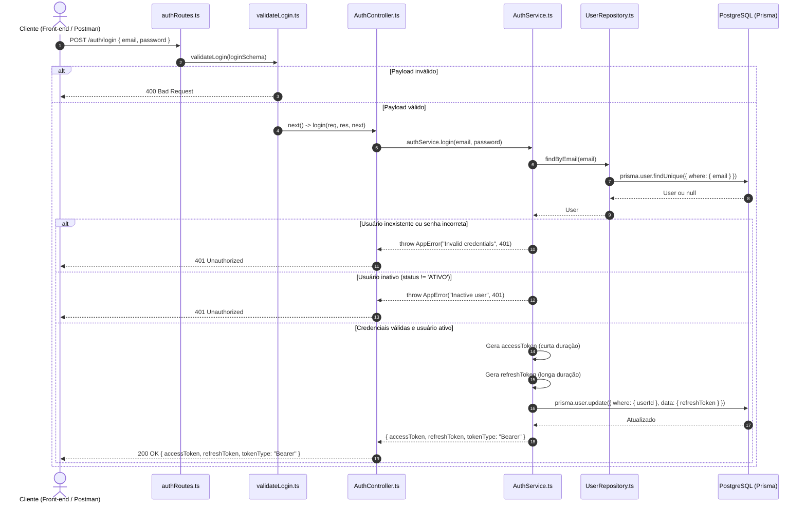
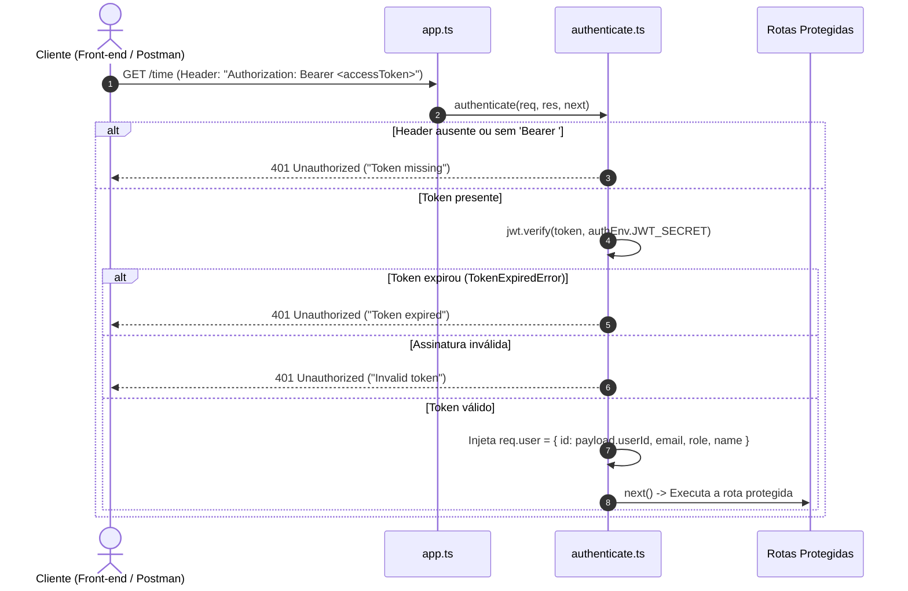
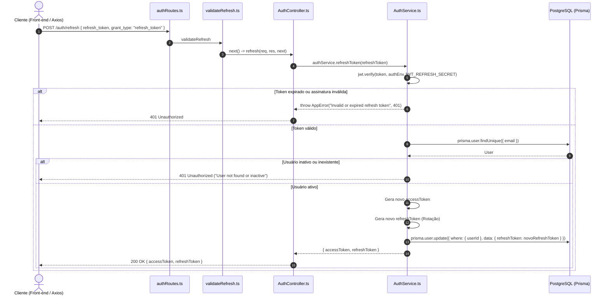
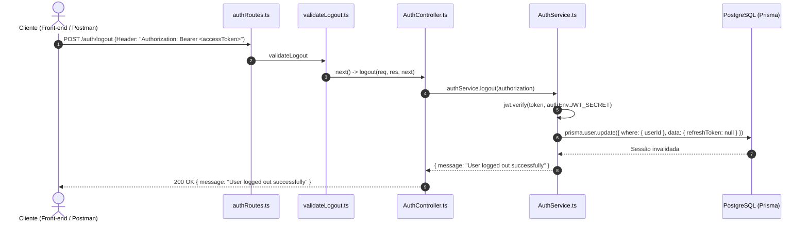

# Fluxo de Autenticação e Autorização (JWT & Refresh Token)

Este documento descreve detalhadamente a arquitetura, os fluxos de requisição e as regras de segurança implementadas no módulo de **Autenticação e Sessão** (`/auth`), cobrindo login, renovação de tokens com rotação (Refresh Token Rotation), logout, janela de tolerância para requisições concorrentes (*Grace Period*) e validação de tokens em rotas protegidas.

---

## 1. Visão Geral dos Componentes

| Camada / Arquivo | Responsabilidade |
| :--- | :--- |
| `src/routes/authRoutes.ts` | Declara as rotas públicas de autenticação (`POST /auth/login`, `POST /auth/refresh`, `POST /auth/logout`). |
| `src/middlewares/validateLogin.ts` | Valida o payload de login (`email` e `password`) com `loginSchema`. |
| `src/middlewares/validateRefresh.ts` | Valida o payload de renovação (`refresh_token` e `grant_type: "refresh_token"`). |
| `src/middlewares/validateLogout.ts` | Valida o cabeçalho `Authorization: Bearer <token>` para logout. |
| `src/controllers/AuthController.ts` | Extrai credenciais e tokens da requisição, aciona o `AuthService` e retorna os status HTTP apropriados. |
| `src/services/AuthService.ts` | Implementa regras de negócio: validação de hash com bcrypt, checagem de usuário ativo, emissão de JWT, rotação de refresh token e invalidação no logout. |
| `src/repositories/UserRepository.ts` | Comunicação com o PostgreSQL via Prisma para consultar o usuário por e-mail e persistir dados. |
| `src/middlewares/authenticate.ts` | Intercepta requisições protegidas, valida a assinatura e expiração do JWT e injeta `req.user = { id, email, role, name }`. |
| `src/types/express.d.ts` | Extensão de tipos do Express para prover tipagem estrita à propriedade `req.user`. |
| `src/schemas/auth.schema.ts` | Validação e tipagem das variáveis de ambiente (`JWT_SECRET`, `JWT_REFRESH_SECRET`, `JWT_EXPIRES_IN`, `JWT_REFRESH_EXPIRES_IN`). |

---

## 2. Fluxo 1: Login (`POST /auth/login`)

Autentica o usuário no sistema com e-mail e senha. Gera um par de tokens (`accessToken` de curta duração e `refreshToken` de longa duração) e persiste o novo `refreshToken` no banco de dados.

### Passo a Passo:
1. **Validação:** O middleware `validateLogin` valida e-mail válido e senha mínima via Zod.
2. **Busca e Checagem de Senha:** O `AuthService` localiza o usuário pelo e-mail e compara a senha informada com o hash salvo via `bcrypt.compare`.
3. **Checagem de Status:** Valida se `user.status === 'ATIVO'`. Usuários inativos recebem erro `401`.
4. **Geração de Tokens:**
   * `accessToken`: assinado com `JWT_SECRET` (validade curta, ex: 15m a 30m).
   * `refreshToken`: assinado com `JWT_REFRESH_SECRET` (validade longa, ex: 7d).
5. **Persistência de Sessão:** O hash do `refreshToken` é gravado na tabela `users` no banco de dados.
6. **Resposta:** Retorna status `200 OK` com ambos os tokens.

---

## 3. Fluxo 2: Requisição a Rota Protegida (Middleware `authenticate`)

Protege qualquer endpoint da API (ex: `/users`, `/clients`, `/projects`, `/time`).

---

## 4. Fluxo 3: Renovação de Token com Rotação (`POST /auth/refresh`)

Quando o `accessToken` expira, o cliente utiliza o `refreshToken` para emitir um novo par de tokens. Para máxima segurança contra roubo de tokens, o sistema adota **Refresh Token Rotation** (o token antigo é substituído por um novo no banco).

### Tratamento de Requisições Concorrentes (*Race Condition* & *Grace Period*):
* **O Problema:** Quando uma tela dispara 3 chamadas simultâneas e o access token está expirado, todas as 3 recebem 401 quase no mesmo instante. Se cada uma disparar um `/auth/refresh` separado, a primeira chamada rotacionará o token no banco, fazendo a segunda e a terceira falharem por token já rotacionado.
* **Proteção no Frontend:** O cliente HTTP deve implementar o **padrão de fila** (ex: variável `isRefreshing` e array `failedQueue`), permitindo que apenas uma chamada execute o refresh enquanto as demais aguardam o novo token.
* **Proteção no Backend (Janela de Tolerância / *Grace Period*):** Para evitar deslogar o usuário caso duas requisições batam no servidor em milissegundos de diferença, o backend implementa uma tolerância temporária (10 a 20 segundos) mantendo a resposta do refresh recente em cache ou aceitando o token anterior recente.

---

## 5. Fluxo 4: Logout (`POST /auth/logout`)

Invalida a sessão do usuário no banco de dados.

---

## 6. Comparativo dos Tokens

| Propriedade | Access Token | Refresh Token |
| :--- | :--- | :--- |
| **Finalidade** | Autenticar chamadas de API (`/time`, `/projects`, etc.) | Emitir novos pares de tokens |
| **Segredo Utilizado** | `JWT_SECRET` | `JWT_REFRESH_SECRET` |
| **Tempo de Vida** | Curto (ex: 15 a 30 minutos) | Longo (ex: 7 dias) |
| **Onde é Enviado** | Cabeçalho `Authorization: Bearer <token>` | Corpo JSON `{ refresh_token, grant_type }` |
| **Persistência no Banco** | Não (Stateless) | Sim (na coluna `refreshToken` de `User`) |
| **Política de Rotação** | Reemitido a cada refresh | Rotacionado a cada refresh |

---

## 7. Boas Práticas Adotadas

* **Segredos Criptográficos Isolados:** Chaves distintas para `accessToken` e `refreshToken` eliminam o risco de ataques de confusão de tipo de token.
* **Rotação de Refresh Token:** Garante que mesmo que um refresh token seja interceptado, ele se torne inválido assim que for utilizado legitimamente pelo usuário.
* **Injeção de Identidade Segura (`req.user`):** O middleware `authenticate` decodifica e anexa `id`, `email` e `role` na requisição, permitindo que módulos como `/time` utilizem o `userId` autenticado sem depender de parâmetros inseguros vindos do cliente.
