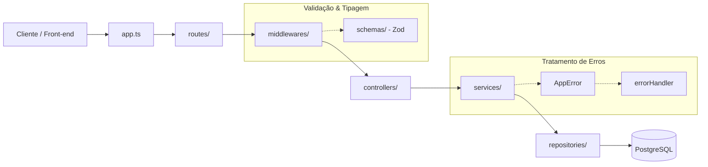
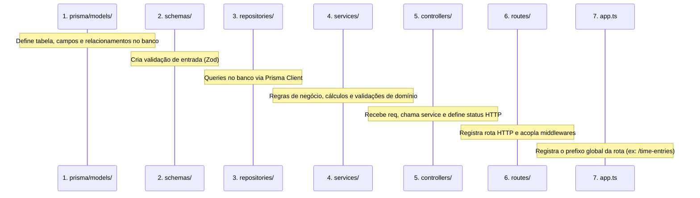

# Guia de Desenvolvimento de Novos Endpoints

Este documento serve como padrão arquitetural e passo a passo para o desenvolvimento de novos módulos e endpoints no projeto **Controle de Horas Backend**.

---

## 1. Visão Geral da Arquitetura

O projeto segue uma arquitetura em camadas (**Layered Architecture**) com clara separação de responsabilidades:



---

## 2. Passo a Passo Recomendado para Criar um Novo Endpoint

Para implementar um novo recurso (exemplo: `TimeEntry` / Apontamento de Horas), siga as etapas na ordem abaixo:



---

## 3. Detalhamento de Cada Camada

### Passo 1: `prisma/models/` — Modelagem do Banco de Dados
* **Objetivo:** Definir como os dados serão estruturados e persistidos no PostgreSQL.
* **O que fazer:** Criar ou atualizar o modelo Prisma correspondente.
* **Comando pós-edição:** Executar `npx prisma migrate dev --name nome_da_migracao` ou `npx prisma generate`.

```prisma
// prisma/models/time_entry.prisma
model TimeEntry {
  id          Int      @id @default(autoincrement())
  userId      Int
  description String?
  date        DateTime
  hours       Decimal  @db.Decimal(4, 2)
  createdAt   DateTime @default(now())
  updatedAt   DateTime @updatedAt

  user        User     @relation(fields: [userId], references: [userId])

  @@map("time_entries")
}
```

---

### Passo 2: `src/schemas/` — Contratos de Entrada (DTOs & Validação Zod)
* **Objetivo:** Validar os dados de entrada (`body`, `query`, `params`) antes que cheguem aos controllers.
* **Regra:** Utilize o formato compatível com o middleware `validateRequest` (aninhando sob `body`, `query` ou `params`).

```typescript
// src/schemas/timeEntry.schema.ts
import { z } from 'zod';

export const createTimeEntrySchema = z.object({
  body: z.object({
    description: z.string().max(255).optional(),
    date: z.string().datetime('Data no formato ISO inválida'),
    hours: z.number().positive('As horas devem ser maiores que zero').max(24, 'Máximo de 24 horas por lançamento'),
  }),
});

export const getTimeEntriesQuerySchema = z.object({
  query: z.object({
    startDate: z.string().optional(),
    endDate: z.string().optional(),
  }),
});
```

---

### Passo 3: `src/repositories/` — Acesso a Dados (DAL)
* **Objetivo:** Isolar todas as operações diretas com o Prisma Client.
* **Regra de Ouro:** **Não** coloque regras de negócio ou validações aqui. Apenas queries simples ou compostas.

```typescript
// src/repositories/TimeEntryRepository.ts
import { prisma } from '@database/prisma';
import type { Prisma, TimeEntry } from '@prisma/client';

export class TimeEntryRepository {
  async create(data: Prisma.TimeEntryUncheckedCreateInput): Promise<TimeEntry> {
    return prisma.timeEntry.create({ data });
  }

  async findByUserId(userId: number): Promise<TimeEntry[]> {
    return prisma.timeEntry.findMany({
      where: { userId },
      orderBy: { date: 'desc' },
    });
  }

  async findById(id: number): Promise<TimeEntry | null> {
    return prisma.timeEntry.findUnique({
      where: { id },
    });
  }
}
```

---

### Passo 4: `src/services/` — Regras de Negócio (BLL)
* **Objetivo:** O coração da aplicação. Onde as decisões e validações lógicas acontecem.
* **Regra de Ouro:** Não acesse objetos de HTTP (`Request` ou `Response`). Receba parâmetros limpos e retorne tipos/dados.
* **Erros operacionais:** Lance sempre instâncias de `AppError` com o código HTTP adequado (400, 401, 403, 404, etc.).

```typescript
// src/services/TimeEntryService.ts
import { TimeEntryRepository } from '@repositories/TimeEntryRepository';
import { AppError } from '@utils/AppError';

export class TimeEntryService {
  constructor(private repository = new TimeEntryRepository()) {}

  async createEntry(userId: number, description?: string, dateStr?: string, hours?: number) {
    if (!dateStr || hours === undefined) {
      throw new AppError('Data e horas são obrigatórios', 400);
    }

    const date = new Date(dateStr);
    if (date > new Date()) {
      throw new AppError('Não é permitido lançar horas em datas futuras', 400);
    }

    return this.repository.create({
      userId,
      description,
      date,
      hours,
    });
  }

  async listUserEntries(userId: number) {
    return this.repository.findByUserId(userId);
  }
}
```

---

### Passo 5: `src/controllers/` — Controle de Requisições HTTP
* **Objetivo:** Receber a requisição, extrair os dados (`req.body`, `req.params`, `req.query`, `req.user`), chamar o service e responder com o status HTTP apropriado.
* **Regra de Ouro:** Sempre encapsule em `try/catch` e repasse erros não tratados via `next(err)`.

```typescript
// src/controllers/TimeEntryController.ts
import type { Request, Response, NextFunction } from 'express';
import { TimeEntryService } from '@services/TimeEntryService';

export class TimeEntryController {
  private service = new TimeEntryService();

  async create(req: Request, res: Response, next: NextFunction): Promise<void> {
    try {
      const userId = Number(req.user!.id);
      const { description, date, hours } = req.body;

      const entry = await this.service.createEntry(userId, description, date, hours);
      res.status(201).json(entry);
    } catch (err) {
      next(err);
    }
  }

  async list(req: Request, res: Response, next: NextFunction): Promise<void> {
    try {
      const userId = Number(req.user!.id);
      const entries = await this.service.listUserEntries(userId);
      res.status(200).json(entries);
    } catch (err) {
      next(err);
    }
  }
}
```

---

### Passo 6: `src/routes/` — Definição dos Endpoints
* **Objetivo:** Declarar as rotas HTTP, acoplar middlewares específicos e ligá-las ao controller correspondente.

```typescript
// src/routes/timeEntryRoutes.ts
import { Router } from 'express';
import { TimeEntryController } from '@controllers/TimeEntryController';
import { validateRequest } from '@middlewares/validateRequest';
import { createTimeEntrySchema } from '@schemas/timeEntry.schema';

const timeEntryRoutes = Router();
const controller = new TimeEntryController();

timeEntryRoutes.post(
  '/',
  validateRequest(createTimeEntrySchema),
  controller.create.bind(controller)
);

timeEntryRoutes.get(
  '/',
  controller.list.bind(controller)
);

export default timeEntryRoutes;
```

---

### Passo 7: `src/app.ts` — Registro Global da Rota
* **Objetivo:** Adicionar o grupo de rotas com seu prefixo e definir a proteção via middleware `authenticate`.

```typescript
// src/app.ts
import timeEntryRoutes from '@routes/timeEntryRoutes';
import { authenticate } from '@middlewares/authenticate';

// Rota protegida: apenas usuários autenticados com token válido acessam
app.use('/time-entries', authenticate, timeEntryRoutes);
```

---

## 4. Tabela de Status Codes Padrão

Ao criar endpoints, siga esta convenção para as respostas HTTP:

| Método | Finalidade | Sucesso | Erro Comum |
| :--- | :--- | :--- | :--- |
| **GET** | Buscar registros | `200 OK` | `404 Not Found` |
| **POST** | Criar registro | `201 Created` | `400 Bad Request` |
| **PUT / PATCH** | Atualizar registro | `200 OK` | `400 Bad Request` / `404 Not Found` |
| **DELETE** | Excluir registro | `204 No Content` | `404 Not Found` |
| **Qualquer** | Falha de autenticação | - | `401 Unauthorized` |
| **Qualquer** | Sem permissão (`role`) | - | `403 Forbidden` |

---

## 5. Checklist Rápido para Novos Endpoints

- [ ] Modelo criado/atualizado em `prisma/models/` e migração executada?
- [ ] Schema Zod com validação criado em `src/schemas/`?
- [ ] Queries no banco criadas em `src/repositories/`?
- [ ] Regras de negócio, cálculos e `AppError` implementados em `src/services/`?
- [ ] Controller criado com `try/catch` e repasse para `next(err)` em `src/controllers/`?
- [ ] Rota associada com `validateRequest` em `src/routes/`?
- [ ] Prefixo da rota registrado em `src/app.ts` com ou sem `authenticate`?
