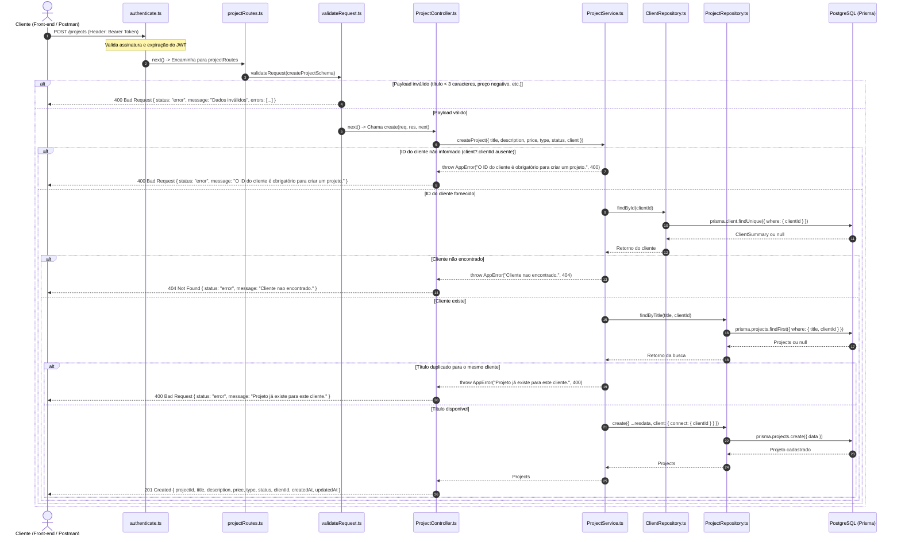
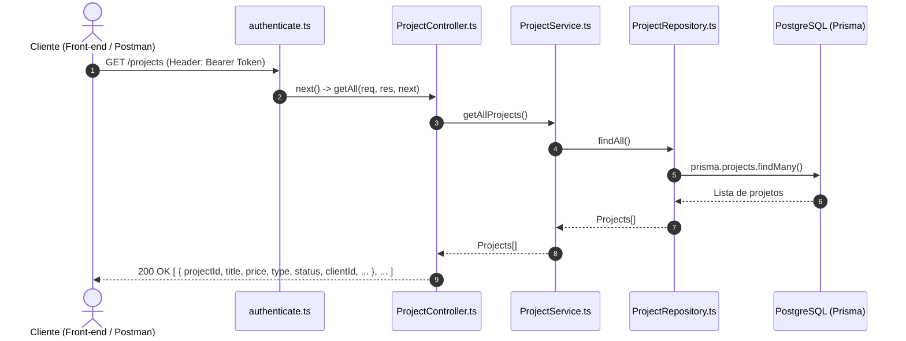
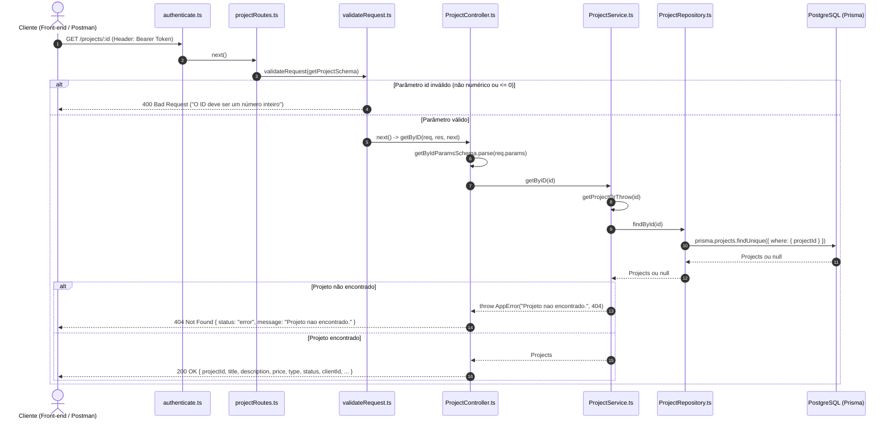
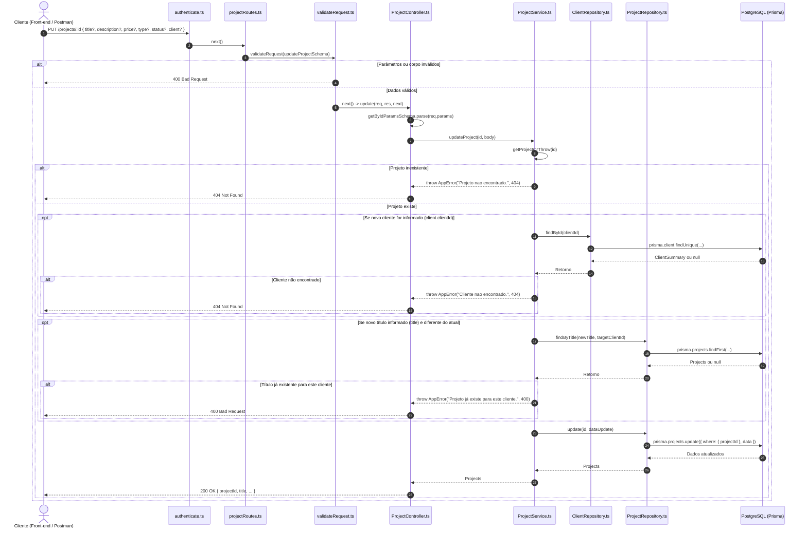
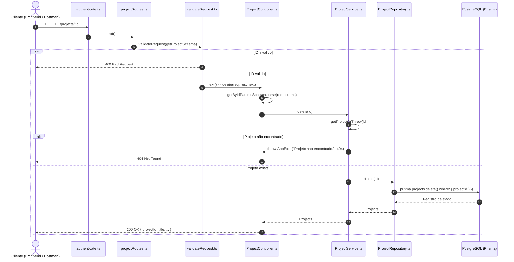

# Fluxo do Módulo de Projetos (CRUD e Regras de Negócio)

Este documento descreve detalhadamente a arquitetura, os fluxos de requisição e as regras de negócio do módulo de **Projetos** (`/projects`), cobrindo validação de schemas, controle de acesso, associação com clientes, persistência no banco e tratamento de erros.

---

## 1. Visão Geral dos Componentes

| Camada / Arquivo | Responsabilidade |
| :--- | :--- |
| `src/app.ts` | Registra o prefixo `/projects`, aplicando o middleware global de autenticação `authenticate` antes de repassar para o roteador. |
| `src/routes/projectRoutes.ts` | Declara as rotas de projetos (`POST /`, `GET /`, `GET /:id`, `PUT /:id`, `DELETE /:id`) e vincula os validadores e métodos do controller. |
| `src/middlewares/authenticate.ts` | Valida o JWT (`accessToken`) no cabeçalho `Authorization: Bearer <token>` e injeta `req.user`. |
| `src/middlewares/validateRequest.ts` | Intercepta requisições e valida `body`, `params` e `query` com schemas Zod antes de chegar ao controller. |
| `src/schemas/project.schema.ts` | Define os schemas Zod de criação (`createProjectSchema`), atualização (`updateProjectSchema`) e consulta (`getProjectSchema`). |
| `src/schemas/id.schema.ts` | Valida e faz coerção de parâmetros de identificador (`id` inteiro e positivo). |
| `src/controllers/ProjectController.ts` | Extrai os dados da requisição, aciona o `ProjectService` e retorna os status HTTP apropriados (`200`, `201`). |
| `src/services/ProjectService.ts` | Implementa regras de negócio: validação de cliente obrigatório, verificação de existência do cliente, unicidade de título por cliente, helper `getProjectOrThrow` e orquestração. |
| `src/repositories/ProjectRepository.ts` | Interage com a tabela `projects` através do Prisma Client. |
| `src/repositories/ClientRepository.ts` | Consulta a existência do cliente vinculado ao projeto (`findById`). |
| `src/middlewares/errorHandler.ts` | Captura exceções da aplicação (`AppError`) e retorna respostas JSON padronizadas com status code customizado. |

---

## 2. Fluxo 1: Criação de Projeto (`POST /projects`)

Cria um novo projeto vinculado a um cliente. Valida se o ID do cliente foi fornecido, se o cliente existe no banco de dados e se não há duplicidade de título para o mesmo cliente. Define status padrão `EM_EXECUCAO` e tipo padrão `ABERTO` se não informados.



### Passo a Passo:
1. **Autenticação:** O middleware `authenticate` verifica a validade do Bearer Token no cabeçalho `Authorization`.
2. **Validação de Schema:** `validateRequest(createProjectSchema)` valida se o título possui ao menos 3 caracteres, se o preço (caso informado) é um número positivo, e se os enums (`type`, `status`) são válidos.
3. **Validação do Cliente:**
   - O `ProjectService` verifica se `client.clientId` foi enviado. Se ausente, lança `AppError("O ID do cliente é obrigatório para criar um projeto.", 400)`.
   - Consulta o repositório de clientes (`ClientRepository.findById`). Se o cliente não existir, lança `AppError("Cliente nao encontrado.", 404)`.
4. **Checagem de Duplicidade de Título:** O serviço verifica se já existe outro projeto com o mesmo título para aquele cliente específico via `ProjectRepository.findByTitle`. Se existir, lança `AppError("Projeto já existe para este cliente.", 400)`.
5. **Persistência no Banco:** Conecta o projeto ao cliente através do `client: { connect: { clientId } }` e insere o registro.
6. **Resposta:** Retorna `201 Created` contendo os dados do projeto criado.

---

## 3. Fluxo 2: Listagem de Projetos (`GET /projects`)

Recupera todos os projetos cadastrados no sistema.



### Passo a Passo:
1. **Autenticação:** Requisição interceptada e autorizada pelo JWT no middleware `authenticate`.
2. **Execução da Consulta:** O controller aciona `ProjectService.getAllProjects()`, que delega para `ProjectRepository.findAll()`.
3. **Consulta ao Banco:** Executa `prisma.projects.findMany()` trazendo todos os registros da tabela `projects`.
4. **Resposta:** Retorna a lista de projetos em formato JSON com status `200 OK`.

---

## 4. Fluxo 3: Busca de Projeto por ID (`GET /projects/:id`)

Recupera os detalhes de um projeto específico a partir do identificador numérico da URL.



### Passo a Passo:
1. **Validação do Parâmetro:** O middleware `validateRequest(getProjectSchema)` valida se `:id` é um número inteiro positivo (e trata query params de paginação caso fornecidos).
2. **Checagem de Existência (`getProjectOrThrow`):** O controller invoca `ProjectService.getByID`, que aciona o método auxiliar privado `getProjectOrThrow`.
3. **Consulta ao Repositório:** Busca o registro via `ProjectRepository.findById`.
4. **Retorno ou Erro:**
   - Se o projeto não for localizado, lança `AppError("Projeto nao encontrado.", 404)`.
   - Se existir, retorna o objeto do projeto com status `200 OK`.

---

## 5. Fluxo 4: Atualização de Projeto (`PUT /projects/:id`)

Atualiza parcialmente ou totalmente os dados de um projeto (`title`, `description`, `price`, `type`, `status` ou vinculação de `client`).



### Passo a Passo:
1. **Validação:** Valida o parâmetro `:id` e o corpo opcional (`title`, `description`, `price`, `type`, `status`, `client`) via `updateProjectSchema`.
2. **Verificação de Existência do Projeto:** Executa `getProjectOrThrow(id)`. Se o projeto não existir, lança erro `404 Not Found`.
3. **Validação de Novo Cliente (se informado):** Caso o payload contenha um novo `client.clientId`, consulta `ClientRepository.findById`. Se o cliente não existir, lança `AppError("Cliente nao encontrado.", 404)`.
4. **Resolução de Cliente Alvo:** Determina o cliente de referência como sendo o novo cliente informado ou o cliente atual já vinculado (`client?.clientId ?? project.clientId`).
5. **Checagem de Duplicidade de Título:** Se o título foi alterado, verifica se o novo título já é utilizado pelo mesmo cliente alvo. Se for, lança `AppError("Projeto já existe para este cliente.", 400)`.
6. **Atualização no Banco:** Invoca `ProjectRepository.update` conectando o novo cliente (se fornecido) e persistindo as alterações.
7. **Resposta:** Retorna `200 OK` com os dados atualizados do projeto.

---

## 6. Fluxo 5: Remoção de Projeto (`DELETE /projects/:id`)

Exclui o registro de um projeto da base de dados após verificar sua existência prévia.



### Passo a Passo:
1. **Validação de ID:** Valida o parâmetro `:id` da rota via `getByIdParamsSchema`.
2. **Verificação Prévia:** Executa `getProjectOrThrow(id)`. Se o projeto não existir, lança erro `404 Not Found`.
3. **Exclusão:** Executa o delete no banco de dados via `ProjectRepository.delete(id)`.
4. **Resposta:** Devolve os dados do projeto excluído com status `200 OK`.

---

## 7. Estruturas e Modelagem de Dados

### Modelo no Banco de Dados (`prisma/models/projects.prisma`)
```prisma
enum StatusProject {
  EM_EXECUCAO
  CONCLUIDO
}

enum TypeProject {
  ABERTO
  FECHADO
}

model Projects {
  projectId   Int           @id @default(autoincrement())
  title       String
  description String?
  price       Float?
  type        TypeProject   @default(ABERTO)
  status      StatusProject @default(EM_EXECUCAO)
  createdAt   DateTime      @default(now())
  updatedAt   DateTime      @updatedAt
  clientId    Int
  client      Client        @relation(fields: [clientId], references: [clientId])

  @@map("projects")
}
```

### Relacionamento com Cliente (`Client`)
Cada projeto pertence obrigatoriamente a um cliente (`clientId` como Foreign Key referenciando `Client.clientId`). O schema Prisma garante a modelagem relacional com a tabela `clients`.

### Schemas Zod de Validação (`src/schemas/project.schema.ts`)
```typescript
export const createProjectSchema = z.object({
  body: z.object({
    title: z.string().min(3, 'O nome deve ter pelo menos 3 caracteres'),
    description: z.string().nullable().optional(),
    price: z.number().positive().nullable().optional(),
    type: z.enum($Enums.TypeProject).optional(),
    status: z.enum($Enums.StatusProject).optional(),
    client: z.object({
      clientId: z.coerce.number({ message: 'O ID deve ser um número' })
        .int({ message: 'O ID deve ser um número inteiro' })
        .positive({ message: 'O ID deve ser maior que 0' })
    }).optional(),
  })
});
```

---

## 8. Tratamento de Erros e Códigos de Status HTTP

| Código | Situação | Exemplo de Mensagem |
| :--- | :--- | :--- |
| `200 OK` | Consulta, atualização ou remoção executada com sucesso. | Objeto `Projects` ou lista de projetos. |
| `201 Created` | Projeto registrado com sucesso. | Objeto `Projects` recém-criado. |
| `400 Bad Request` | Falha de validação Zod (título curto, preço inválido), ID do cliente ausente ou título duplicado para o cliente. | `"O ID do cliente é obrigatório para criar um projeto."` ou `"Projeto já existe para este cliente."` |
| `401 Unauthorized` | Token de autenticação ausente, corrompido ou expirado. | `"Token missing"` / `"Token expired"` / `"Invalid token"`. |
| `404 Not Found` | O `id` do projeto ou o `clientId` informado não foi localizado. | `"Projeto nao encontrado."` ou `"Cliente nao encontrado."` |
| `500 Internal Server Error` | Erros inesperados de infraestrutura ou banco de dados. | `"Internal Server Error"`. |

---

## 9. Boas Práticas Adotadas

* **Proteção Global da Rota:** Todas as rotas filhas de `/projects` exigem autenticação JWT ativa através do middleware `authenticate` em `app.ts`.
* **Validação Rigorosa de Entrada:** Schemas Zod asseguram que os tipos de dados e restrições (ex: tamanho mínimo do título, valores positivos) sejam validados antes da execução dos controllers.
* **Integridade Referencial em Nível de Serviço:** O serviço valida ativamente a existência do cliente vinculado (`clientRepository.findById`) antes de criar ou atualizar o projeto, retornando `404 Not Found` em vez de falhas genéricas de banco.
* **Regra de Unicidade por Escopo:** A unicidade do título do projeto é contextualizada pelo cliente (`title + clientId`), permitindo que clientes distintos tenham projetos com nomes idênticos sem conflitos.
* **Princípio DRY (Don't Repeat Yourself):** Utilização do método helper privado `getProjectOrThrow` em `ProjectService` para unificar a verificação de existência e tratamento de 404 em consultas individuais, updates e deleções.
* **Arquitetura em Camadas (Separation of Concerns):** Roteamento, validação, controle de requisição, regras de negócio e persistência no banco são completamente desacoplados em classes e módulos com responsabilidade única.


### Atualizações adicionais

- **Autorização:** As rotas de criação, atualização e exclusão (`POST`, `PUT`, `DELETE`) exigem a role `ADMIN`. Apenas usuários com `role: "ADMIN"` podem acessar essas rotas; as rotas de listagem (`GET`) são abertas a qualquer usuário autenticado.
