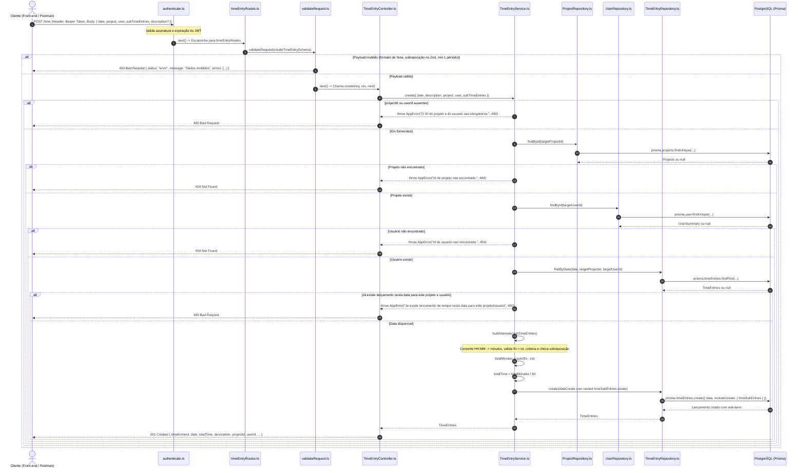
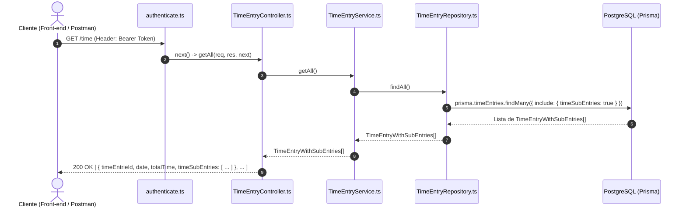
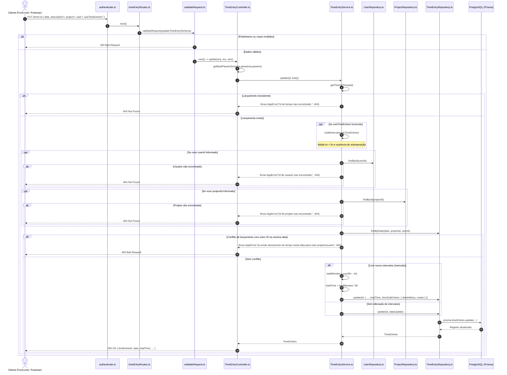
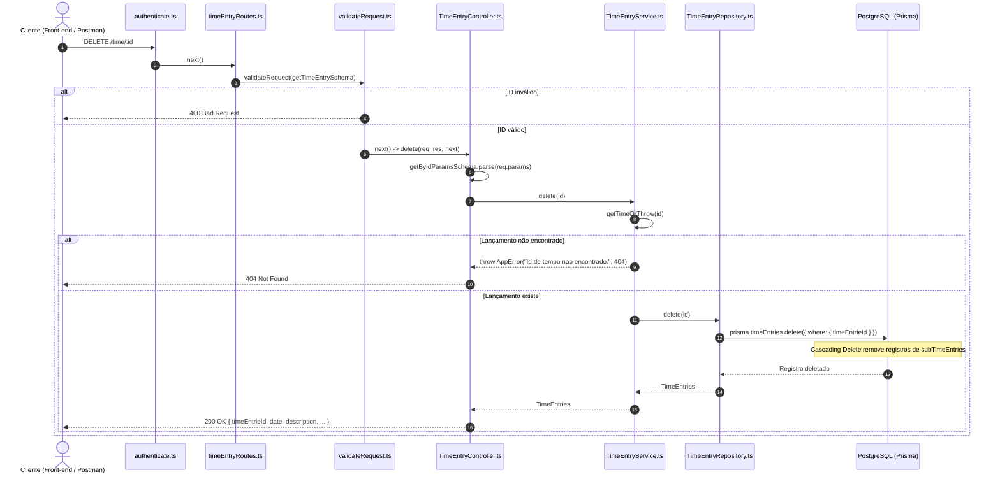

# Fluxo do Módulo de Lançamento de Horas (Time Entries & SubTimeEntries)

Este documento descreve detalhadamente a arquitetura, os fluxos de requisição e as regras de negócio do módulo de **Lançamento de Horas** (`/time`), cobrindo validação de schemas Zod, controle de acesso JWT, integridade referencial com projetos e usuários, decomposição em intervalos de tempo (**SubTimeEntries**), cálculo automático de total de horas, prevenção de sobreposição de horários e persistência transacional com o Prisma.

---

## 1. Visão Geral dos Componentes

| Camada / Arquivo | Responsabilidade |
| :--- | :--- |
| `src/app.ts` | Registra o prefixo `/time`, aplicando o middleware global de autenticação `authenticate` antes de repassar para o roteador. |
| `src/routes/timeEntryRoutes.ts` | Declara as rotas de lançamentos de horas (`POST /`, `GET /`, `GET /:id`, `PUT /:id`, `DELETE /:id`) e vincula os validadores e métodos do controller. |
| `src/middlewares/authenticate.ts` | Valida o JWT (`accessToken`) no cabeçalho `Authorization: Bearer <token>` e injeta `req.user`. |
| `src/middlewares/validateRequest.ts` | Intercepta requisições e valida `body`, `params` e `query` com schemas Zod antes de chegar ao controller. |
| `src/schemas/timeEntry.schema.ts` | Define os schemas Zod de criação (`createTimeEntrySchema`), atualização (`updateTimeEntrySchema`) e consulta (`getTimeEntrySchema`), incluindo validação de formato `HH:MM`, verificação de `hourFin > hourIni` e detecção de sobreposição de intervalos no array `subTimeEntries`. |
| `src/schemas/id.schema.ts` | Valida e faz coerção de parâmetros de identificador (`id` inteiro e positivo). |
| `src/controllers/TimeEntryController.ts` | Extrai os dados da requisição, aciona o `TimeEntryService` e retorna os status HTTP apropriados (`200`, `201`). |
| `src/services/TimeEntryService.ts` | Implementa regras de negócio: validação de IDs de projeto e usuário, integridade relacional, unicidade de lançamento por dia/projeto/usuário, ordenação e validação de sobreposição de intervalos (`buildIntervals`), cálculo do `totalTime` em horas decimais, conversão de horários (`minutesToTimeDate`), substituição atômica de sub-itens no update e helper `getTimeOrThrow`. |
| `src/repositories/TimeEntryRepository.ts` | Interage com as tabelas `timeentries` e `subTimeEntries` através do Prisma Client, definindo argumentos de `include` (`timeEntryWithSubEntriesArgs`) para trazer os sub-lançamentos associados. |
| `src/repositories/ProjectRepository.ts` | Consulta a existência do projeto associado ao lançamento (`findById`). |
| `src/repositories/UserRepository.ts` | Consulta a existência do usuário associado ao lançamento (`findById`). |
| `src/middlewares/errorHandler.ts` | Captura exceções da aplicação (`AppError`) e retorna respostas JSON padronizadas com status code customizado. |

---

## 2. Fluxo 1: Criação de Lançamento com Intervalos (`POST /time`)

Cria um lançamento de horas atrelado a um projeto e usuário contendo um ou mais intervalos (`subTimeEntries`). O sistema valida que `hourFin > hourIni` em cada período, impede sobreposição entre os intervalos, calcula a soma das durações (`totalTime`) e persiste tudo de forma atômica no banco de dados.



### Passo a Passo:
1. **Autenticação:** O middleware `authenticate` verifica a validade do JWT Bearer no cabeçalho `Authorization`.
2. **Validação de Schema (Zod):**
   * Transforma a string `date` (`AAAA-MM-DD`) em objeto `Date`.
   * Sanitiza `description` (aplica `trim` e transforma string vazia em `null`).
   * Valida cada item de `subTimeEntries`:
     * `hourIni` e `hourFin` no formato `HH:MM`.
     * `refine`: garante que `hourFin > hourIni`.
   * `.superRefine`: ordena os intervalos e valida que não haja sobreposição horária (`current.hourIni < previus.hourFin`).
3. **Validação de Integridade Relacional:**
   * Verifica se `projectId` e `userId` foram enviados.
   * Consulta `ProjectRepository.findById`. Se não existir, lança erro `404 Not Found`.
   * Consulta `UserRepository.findById`. Se não existir, lança erro `404 Not Found`.
4. **Prevenção de Duplicidade:**
   * Executa `TimeEntryRepository.findByDate(date, targetProjectId, targetUserId)`. Se já houver apontamento registrado para o mesmo dia, projeto e usuário, lança erro `400 Bad Request`.
5. **Processamento dos Intervalos e Cálculo de Horas:**
   * `buildIntervals`: converte os horários `HH:MM` para minutos absolutos (`hhmmToMinutes`), valida a consistência e ordena.
   * `totalMinutes`: soma a diferença de minutos de todos os intervalos cadastrados.
   * `totalTime`: calcula as horas decimais (`totalMinutes / 60`) e salva no cabeçalho do lançamento.
   * `minutesToTimeDate`: monta objetos `Date` completos combinando a data base com as horas e minutos calculados, além de gerar o `totalHour` textual (`HH:MM:SS.sssZ`).
6. **Persistência Aninhada no Prisma:**
   * O registro pai (`TimeEntries`) é criado conectando o projeto e o usuário, criando simultaneamente todos os `SubTimeEntries` na mesma transação.
7. **Resposta:** Retorna status `201 Created` com o lançamento persistido.

---

## 3. Fluxo 2: Listagem de Lançamentos com Sub-itens (`GET /time`)

Recupera todos os apontamentos de horas cadastrados, trazendo embutido o array completo de sub-intervalos (`timeSubEntries`).



### Passo a Passo:
1. **Autenticação:** Requisição interceptada e autorizada pelo JWT no middleware `authenticate`.
2. **Execução da Consulta:** O controller aciona `TimeEntryService.getAll()`, que delega para `TimeEntryRepository.findAll()`.
3. **Consulta Enriquecida ao Banco:** Executa `prisma.timeEntries.findMany(timeEntryWithSubEntriesArgs)`, aplicando `include: { timeSubEntries: true }`.
4. **Resposta:** Retorna o array de objetos `TimeEntryWithSubEntries[]` com status `200 OK`.

---

## 4. Fluxo 3: Busca de Lançamento por ID (`GET /time/:id`)

Recupera os detalhes de um lançamento específico a partir do identificador numérico da URL.


### Passo a Passo:
1. **Validação de ID:** Valida `:id` inteiro positivo via `getByIdParamsSchema`.
2. **Checagem de Existência (`getTimeOrThrow`):** `TimeEntryService.getByID` invoca o método privado `getTimeOrThrow`.
3. **Consulta Prisma com Include:** `TimeEntryRepository.findById` executa `findUnique` aplicando `timeEntryWithSubEntriesArgs`.
4. **Retorno:** Devolve o objeto completo com seus `timeSubEntries` associados com status `200 OK` ou lança `404 Not Found`.

---

## 5. Fluxo 4: Atualização de Lançamento e Intervalos (`PUT /time/:id`)

Atualiza os dados de um lançamento (`date`, `description`, `project`, `user`) e substitui opcionalmente os intervalos (`subTimeEntries`), recalculando o `totalTime` e garantindo atomicidade.



### Passo a Passo:
1. **Validação:** Valida o parâmetro `:id` e o corpo da requisição via `updateTimeEntrySchema`.
2. **Verificação de Existência:** Executa `getTimeOrThrow(id)`. Se não existir, lança erro `404 Not Found`.
3. **Validação Prévia dos Intervalos:** Se `subTimeEntries` estiver presente no corpo, aciona `buildIntervals(subTimeEntries)` antes de tocar no banco de dados.
4. **Validação Relacional Opcional:** Verifica existência de novo `user` ou `project`, caso fornecidos.
5. **Checagem de Duplicidade:** Garante que a data informada não entre em conflito com outro lançamento do mesmo projeto/usuário (`timeEntrieId !== id`).
6. **Substituição Atômica dos Intervalos:**
   * Recalcula `totalTime` com a soma dos novos intervalos.
   * Usa a instrução Prisma:
     ```typescript
     timeSubEntries: {
       deleteMany: { timeEntrieId: timeEntrieId },
       create: intervals.map(...)
     }
     ```
     Isso descarta os intervalos anteriores e insere os novos em uma única operação segura.
7. **Resposta:** Retorna `200 OK` com os dados atualizados.

---

## 6. Fluxo 5: Remoção de Lançamento de Horas (`DELETE /time/:id`)

Exclui o lançamento pai e remove automaticamente todos os seus sub-intervalos através da cláusula `onDelete: Cascade` do Prisma.



### Passo a Passo:
1. **Validação de ID:** Valida o parâmetro `:id` da rota via `getByIdParamsSchema`.
2. **Verificação Prévia:** Executa `getTimeOrThrow(id)`. Se não encontrado, lança erro `404 Not Found`.
3. **Exclusão em Cascata:** Executa `TimeEntryRepository.delete(id)`. Pela configuração `onDelete: Cascade` na relação de `SubTimeEntries`, o PostgreSQL remove atomicamente todos os sub-intervalos vinculados.
4. **Resposta:** Devolve os dados do lançamento excluído com status `200 OK`.

---

## 7. Estruturas e Modelagem de Dados

### Modelo do Apontamento Principal (`prisma/models/timeEntries.prisma`)
```prisma
model TimeEntries {
  timeEntrieId   Int              @id @default(autoincrement())
  date           DateTime         @db.Date
  totalTime      Float?
  description    String?          @db.Text
  createdAt      DateTime         @default(now())
  updatedAt      DateTime         @updatedAt

  projectId      Int
  project        Projects         @relation(fields: [projectId], references: [projectId])

  userId         Int
  user           User             @relation(fields: [userId], references: [userId])

  timeSubEntries SubTimeEntries[]

  @@map("timeentries")
}
```

### Modelo dos Sub-Intervalos (`prisma/models/subTimeEntries.prisma`)
```prisma
model SubTimeEntries {
  subTimeEntryId Int         @id @default(autoincrement())
  hourIni        DateTime
  hourFin        DateTime
  totalHour      String?
  createdAt      DateTime    @default(now())
  updatedAt      DateTime    @updatedAt

  timeEntrieId   Int
  timeEntrie     TimeEntries @relation(fields: [timeEntrieId], references: [timeEntrieId], onDelete: Cascade)

  @@map("subTimeEntries")
}
```

### Contrato de Retorno com Relações (`TimeEntryWithSubEntries`)
No [`TimeEntryRepository.ts`](file:///c:/Cursos/Projetos/controle-horas-backend-ts/src/repositories/TimeEntryRepository.ts):
```typescript
export const timeEntryWithSubEntriesArgs = {
  include: {
    timeSubEntries: true,
  },
} satisfies Prisma.TimeEntriesFindManyArgs;

export type TimeEntryWithSubEntries = Prisma.TimeEntriesGetPayload<typeof timeEntryWithSubEntriesArgs>;
```

### Schemas Zod de Validação de Intervalos (`src/schemas/timeEntry.schema.ts`)
```typescript
const timeEntryPeriodSchema = z.object({
  hourIni: z.iso.time({ message: "A hora inicial deve estar no formato (HH:MM)" }),
  hourFin: z.iso.time({ message: "A hora final deve estar no formato (HH:MM)" }),
}).refine((period) => toMinutes(period.hourIni) < toMinutes(period.hourFin), {
  message: "A hora final deve ser maior que a hora inicial",
});

export const createTimeEntrySchema = z.object({
  body: z.object({
    date: z.iso.date({ message: "A data deve estar no formato (AAAA-MM-DD)" })
      .transform((val) => new Date(`${val}T12:00:00.000Z`)),
    description: z.string().trim().nullish().transform((val) => (val === "" ? null : val)),
    project: z.object({
      projectId: z.coerce.number().int().positive()
    }),
    user: z.object({
      userId: z.coerce.number().int().positive()
    }),
    subTimeEntries: z.array(timeEntryPeriodSchema)
      .min(1, { message: "Informe ao menos um período de inicio e fim" })
      .superRefine((periods, ctx) => {
        const sorted = [...periods].sort((a, b) => toMinutes(a.hourIni) - toMinutes(b.hourFin));
        for (let i = 1; i < sorted.length; i++) {
          if (toMinutes(sorted[i].hourIni) < toMinutes(sorted[i - 1].hourFin)) {
            ctx.addIssue({
              code: "custom",
              message: "Os períodos não podem se sobrepor",
              path: ["subTimeEntries"],
            });
          }
        }
      })
  })
});
```

---

## 8. Tratamento de Erros e Códigos de Status HTTP

| Código | Situação | Exemplo de Mensagem |
| :--- | :--- | :--- |
| `200 OK` | Consulta, atualização ou remoção executada com sucesso. | Objeto `TimeEntries` ou lista `TimeEntryWithSubEntries[]`. |
| `201 Created` | Apontamento de tempo e sub-intervalos registrados com sucesso. | Objeto `TimeEntries` recém-criado. |
| `400 Bad Request` | Falha de validação Zod (formato `HH:MM`, `hourFin <= hourIni`, sobreposição de períodos, ausência de períodos obrigatórios) ou lançamento duplicado para a mesma data/usuário/projeto. | `"Os períodos não podem se sobrepor"`, `"A hora final deve ser maior que a hora inicial"` ou `"Ja existe lancamento de tempo nesta data para este projeto/usuario"`. |
| `401 Unauthorized` | Token de autenticação JWT ausente, expirado ou corrompido. | `"Token missing"` / `"Token expired"` / `"Invalid token"`. |
| `404 Not Found` | O `id` do lançamento, o `projectId` ou o `userId` não foi localizado. | `"Id de tempo nao encontrado."`, `"Id de projeto nao encontrado."` ou `"Id de usuario nao encontrado."`. |
| `500 Internal Server Error` | Falhas inesperadas de banco de dados ou infraestrutura. | `"Internal Server Error"`. |

---

## 9. Boas Práticas Adotadas

* **Validação em Camadas (Zod + Domain Service):** A integridade dos horários e intervalos é verificada tanto na entrada via schema Zod (`timeEntryPeriodSchema` e `.superRefine`) quanto dentro do `TimeEntryService` (`buildIntervals`), garantindo consistência em qualquer canal de entrada.
* **Cálculo Automatizado de Horas (`totalTime`):** O usuário informa os horários de início e término (`HH:MM`) e a aplicação calcula com precisão a duração total em minutos e converte para horas decimais (`totalMinutes / 60`), evitando erros manuais de cálculo.
* **Prevenção de Sobreposição Temporal:** Algoritmo de ordenação e comparação de adjacência que impede apontamentos de horários conflitantes no mesmo dia para o mesmo colaborador.
* **Operações Transacionais com Prisma:** Na criação e atualização, a persistência do lançamento pai e a substituição/criação dos `timeSubEntries` ocorrem de forma atômica (incluindo `deleteMany + create` no update).
* **Integridade Referencial com Cascade Delete:** Configuração `@relation(..., onDelete: Cascade)` no modelo `SubTimeEntries`, garantindo que a exclusão de um lançamento limpe seus intervalos sem deixar registros órfãos.
* **Tipagem Segura com `Prisma.TimeEntriesGetPayload`:** A camada de repositório exporta `TimeEntryWithSubEntries`, fornecendo ao TypeScript conhecimento exato sobre os relacionamentos incluídos em `findAll` e `findById`.
* **Tratamento de Timezone e Fuso Horário:** Uso de `formatarDataComOffset` para garantir que as datas geradas para os horários `hourIni` e `hourFin` reflitam a data local correta sem desvios de GMT.
