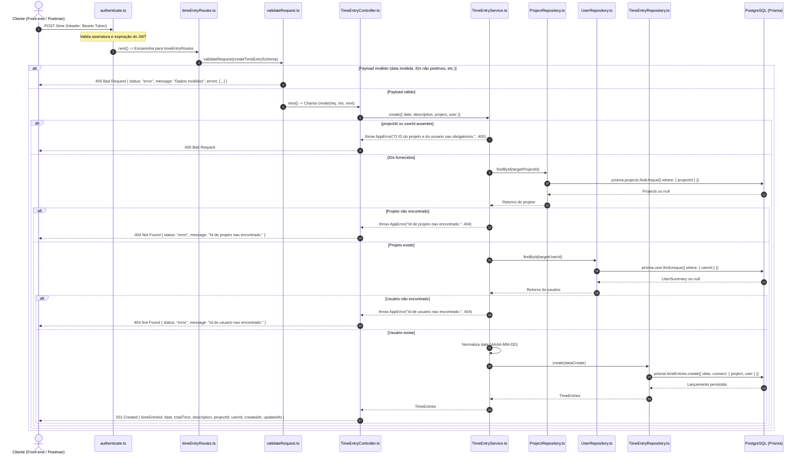
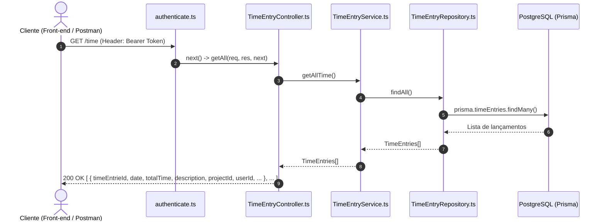
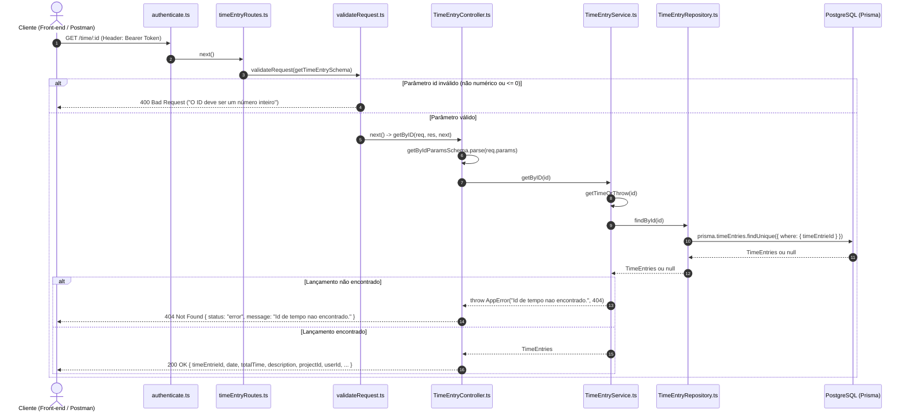
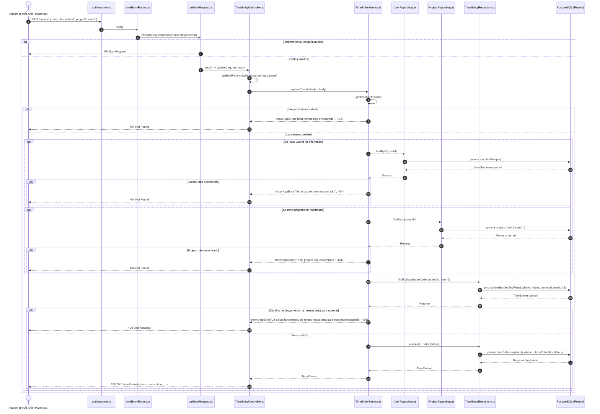
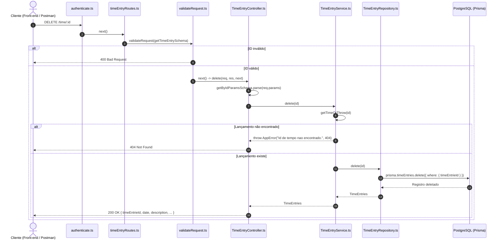

# Fluxo do Módulo de Lançamento de Horas (Time Entries) (CRUD e Regras de Negócio)

Este documento descreve detalhadamente a arquitetura, os fluxos de requisição e as regras de negócio do módulo de **Lançamento de Horas** (`/time`), cobrindo validação de schemas Zod, controle de acesso JWT, integridade referencial com projetos e usuários, normalização de datas, prevenção de duplicidade e tratamento de erros.

---

## 1. Visão Geral dos Componentes

| Camada / Arquivo | Responsabilidade |
| :--- | :--- |
| `src/app.ts` | Registra o prefixo `/time`, aplicando o middleware global de autenticação `authenticate` antes de repassar para o roteador. |
| `src/routes/timeEntryRoutes.ts` | Declara as rotas de lançamentos de horas (`POST /`, `GET /`, `GET /:id`, `PUT /:id`, `DELETE /:id`) e vincula os validadores e métodos do controller. |
| `src/middlewares/authenticate.ts` | Valida o JWT (`accessToken`) no cabeçalho `Authorization: Bearer <token>` e injeta `req.user`. |
| `src/middlewares/validateRequest.ts` | Intercepta requisições e valida `body`, `params` e `query` com schemas Zod antes de chegar ao controller. |
| `src/schemas/timeEntry.schema.ts` | Define os schemas Zod de criação (`createTimeEntrySchema`), atualização (`updateTimeEntrySchema`) e consulta (`getTimeEntrySchema`), tratando formato de data ISO e sanitização de descrição. |
| `src/schemas/id.schema.ts` | Valida e faz coerção de parâmetros de identificador (`id` inteiro e positivo). |
| `src/controllers/TimeEntryController.ts` | Extrai os dados da requisição, aciona o `TimeEntryService` e retorna os status HTTP apropriados (`200`, `201`). |
| `src/services/TimeEntryService.ts` | Implementa regras de negócio: validação de obrigatoriedade de projeto e usuário, verificação de existência no banco, normalização de data (AAAA-MM-DD), prevenção de duplicidade, helper `getTimeOrThrow` e orquestração. |
| `src/repositories/TimeEntryRepository.ts` | Interage com a tabela `timeentries` através do Prisma Client (`create`, `findAll`, `findById`, `findByDate`, `update`, `delete`). |
| `src/repositories/ProjectRepository.ts` | Consulta a existência do projeto associado ao lançamento (`findById`). |
| `src/repositories/UserRepository.ts` | Consulta a existência do usuário associado ao lançamento (`findById`). |
| `src/middlewares/errorHandler.ts` | Captura exceções da aplicação (`AppError`) e retorna respostas JSON padronizadas com status code customizado. |

---

## 2. Fluxo 1: Criação de Lançamento de Horas (`POST /time`)

Registra um novo apontamento de tempo vinculado a um projeto e a um usuário. Valida formato de data, garante a existência do projeto e do usuário antes da persistência e normaliza o campo `date` para a meia-noite da data informada.



### Passo a Passo:
1. **Autenticação:** O middleware `authenticate` verifica a validade do Bearer Token no cabeçalho `Authorization`.
2. **Validação de Schema:** `validateRequest(createTimeEntrySchema)`:
   - Valida o campo `date` no formato ISO 8601 (`AAAA-MM-DD`) e o transforma em `Date`.
   - Limpa espaços (`trim`) e converte descrições vazias para `null`.
   - Valida `project.projectId` e `user.userId` como inteiros positivos.
3. **Validação de Integridade Referencial:**
   - O `TimeEntryService` verifica se `projectId` e `userId` foram fornecidos.
   - Consulta `ProjectRepository.findById`. Se não existir, lança `AppError("Id de projeto nao encontrado.", 404)`.
   - Consulta `UserRepository.findById`. Se não existir, lança `AppError("Id de usuario nao encontrado.", 404)`.
4. **Normalização de Data:** A data é fatiada (`date.toISOString().split('T')[0]`) e instanciada como uma nova `Date`, garantindo armazenamento uniforme no campo `@db.Date`.
5. **Persistência com Relações:** O registro é inserido no banco conectando com as entidades correspondentes (`project: { connect: { projectId } }`, `user: { connect: { userId } }`).
6. **Resposta:** Retorna `201 Created` contendo o lançamento criado.

---

## 3. Fluxo 2: Listagem de Lançamentos de Horas (`GET /time`)

Recupera todos os lançamentos de horas cadastrados no sistema.



### Passo a Passo:
1. **Autenticação:** Requisição validada pelo middleware `authenticate`.
2. **Execução da Consulta:** O controller aciona `TimeEntryService.getAllTime()`, que delega para `TimeEntryRepository.findAll()`.
3. **Consulta ao Banco:** Executa `prisma.timeEntries.findMany()` trazendo todos os registros da tabela `timeentries`.
4. **Resposta:** Retorna a lista de apontamentos com status `200 OK`.

---

## 4. Fluxo 3: Busca de Lançamento por ID (`GET /time/:id`)

Recupera os detalhes de um lançamento de horas específico a partir do identificador numérico da URL.



### Passo a Passo:
1. **Validação do Parâmetro:** O middleware `validateRequest(getTimeEntrySchema)` valida se `:id` é um número inteiro positivo (e trata query params de paginação caso fornecidos).
2. **Checagem de Existência (`getTimeOrThrow`):** O controller invoca `TimeEntryService.getByID`, que executa o helper privado `getTimeOrThrow`.
3. **Consulta ao Repositório:** Busca o registro via `TimeEntryRepository.findById`.
4. **Retorno ou Erro:**
   - Se o registro não for localizado, lança `AppError("Id de tempo nao encontrado.", 404)`.
   - Se existir, retorna o objeto com status `200 OK`.

---

## 5. Fluxo 4: Atualização de Lançamento de Horas (`PUT /time/:id`)

Atualiza os dados de um lançamento (`date`, `description`, `project` ou `user`), prevenindo duplicidade de lançamentos para o mesmo usuário/projeto na mesma data.



### Passo a Passo:
1. **Validação:** Valida o parâmetro `:id` e o corpo da requisição via `updateTimeEntrySchema`.
2. **Verificação de Existência:** Executa `getTimeOrThrow(id)`. Se não existir, lança erro `404 Not Found`.
3. **Validação de Usuário (se informado):** Caso o payload traga `user.userId`, verifica existência no `UserRepository`. Se inexistente, lança `AppError("Id de usuario nao encontrado.", 404)`.
4. **Validação de Projeto (se informado):** Caso o payload traga `project.projectId`, verifica existência no `ProjectRepository`. Se inexistente, lança `AppError("Id de projeto nao encontrado.", 404)`.
5. **Checagem de Duplicidade:** Consulta se já existe apontamento na mesma data para o projeto/usuário via `TimeEntryRepository.findByDate`. Se existir e o ID for diferente do registro atual, lança `AppError("Ja existe lancamento de tempo nesta data para este projeto/usuario", 400)`.
6. **Atualização no Banco:** Invoca `TimeEntryRepository.update` conectando as relações caso alteradas e atualizando os campos.
7. **Resposta:** Retorna `200 OK` com os dados atualizados.

---

## 6. Fluxo 5: Remoção de Lançamento de Horas (`DELETE /time/:id`)

Exclui o registro de apontamento de tempo do banco de dados após validação de existência prévia.



### Passo a Passo:
1. **Validação de ID:** Valida o parâmetro `:id` da rota via `getByIdParamsSchema`.
2. **Verificação Prévia:** Executa `getTimeOrThrow(id)`. Se não encontrado, lança `404 Not Found`.
3. **Exclusão:** Executa o delete no banco via `TimeEntryRepository.delete(id)`.
4. **Resposta:** Devolve os dados do lançamento excluído com status `200 OK`.

---

## 7. Estruturas e Modelagem de Dados

### Modelo no Banco de Dados (`prisma/models/timeEntries.prisma`)
```prisma
model TimeEntries {
  timeEntrieId Int      @id @default(autoincrement())
  date         DateTime @db.Date
  totalTime    Float?
  description  String?  @db.Text
  createdAt    DateTime @default(now())
  updatedAt    DateTime @updatedAt

  projectId Int
  project   Projects @relation(fields: [projectId], references: [projectId])

  userId Int
  user   User @relation(fields: [userId], references: [userId])

  @@map("timeentries")
}
```

### Relacionamentos
* **Projeto (`Projects`):** N:1 — Cada lançamento pertence obrigatoriamente a um projeto (`projectId`).
* **Usuário (`User`):** N:1 — Cada lançamento pertence obrigatoriamente a um colaborador/usuário (`userId`).

### Schemas Zod de Validação (`src/schemas/timeEntry.schema.ts`)
```typescript
export const createTimeEntrySchema = z.object({
  body: z.object({
    date: z.iso.date({ message: "A data deve estar no formato (AAAA-MM-DD)" })
      .transform((val) => new Date(val)),
    description: z.string()
      .trim()
      .nullish()
      .transform((val) => (val === "" ? null : val)),
    project: z.object({
      projectId: z.coerce.number({ message: 'O ID deve ser um número' })
        .int({ message: 'O ID deve ser um número inteiro' })
        .positive({ message: 'O ID deve ser maior que 0' })
    }),
    user: z.object({
      userId: z.coerce.number({ message: 'O ID deve ser um número' })
        .int({ message: 'O ID deve ser um número inteiro' })
        .positive({ message: 'O ID deve ser maior que 0' })
    }),
  })
});
```

---

## 8. Tratamento de Erros e Códigos de Status HTTP

| Código | Situação | Exemplo de Mensagem |
| :--- | :--- | :--- |
| `200 OK` | Consulta, atualização ou remoção executada com sucesso. | Objeto `TimeEntries` ou lista de lançamentos. |
| `201 Created` | Apontamento de tempo registrado com sucesso. | Objeto `TimeEntries` recém-criado. |
| `400 Bad Request` | Falha de validação Zod (formato de data inválido, ID inválido), ausência de IDs obrigatórios ou duplicidade de lançamento para a mesma data/usuário/projeto. | `"O ID do projeto e do usuario sao obrigatorios."` ou `"Ja existe lancamento de tempo nesta data para este projeto/usuario"` |
| `401 Unauthorized` | Token de autenticação ausente, expirado ou inválido. | `"Token missing"` / `"Token expired"` / `"Invalid token"`. |
| `404 Not Found` | O `id` do lançamento, o `projectId` ou o `userId` não foi localizado no banco. | `"Id de tempo nao encontrado."`, `"Id de projeto nao encontrado."` ou `"Id de usuario nao encontrado."` |
| `500 Internal Server Error` | Falhas inesperadas de banco de dados ou infraestrutura. | `"Internal Server Error"`. |

---

## 9. Boas Práticas Adotadas

* **Proteção Global da Rota:** Todas as rotas sob o prefixo `/time` são protegidas com o middleware `authenticate` em `app.ts`.
* **Validação e Transformação de Datas com Zod:** Uso de `z.iso.date()` garantindo formato estrito (`AAAA-MM-DD`), seguido por transformação automática para objeto `Date`.
* **Normalização de Data no Serviço:** Garantia de persistência sem ruído de fuso horário/horário (`new Date(date.toISOString().split('T')[0])`) no campo `@db.Date`.
* **Sanitização de Strings:** Descrição tratada com `.trim()` e conversão de strings vazias para `null`, preservando a consistência dos dados salvos no banco.
* **Integridade Referencial em Duas Entidades:** O serviço garante ativamente que tanto o `Project` quanto o `User` existam antes da inserção ou modificação, evitando violações de FK e gerando mensagens claras de 404.
* **Prevenção de Duplicidade:** Regra de negócio explícita no update que impede que mais de um apontamento seja registrado para a mesma combinação de projeto, usuário e data.
* **Princípio DRY (Don't Repeat Yourself):** Utilização do método helper privado `getTimeOrThrow` em `TimeEntryService` para centralizar a busca e o tratamento de 404 em buscas, atualizações e exclusões.
* **Arquitetura em Camadas:** Separação estrita de responsabilidades entre rotas, validadores de requisição, controllers, serviços e repositórios Prisma.

