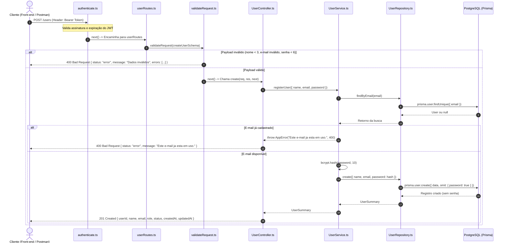
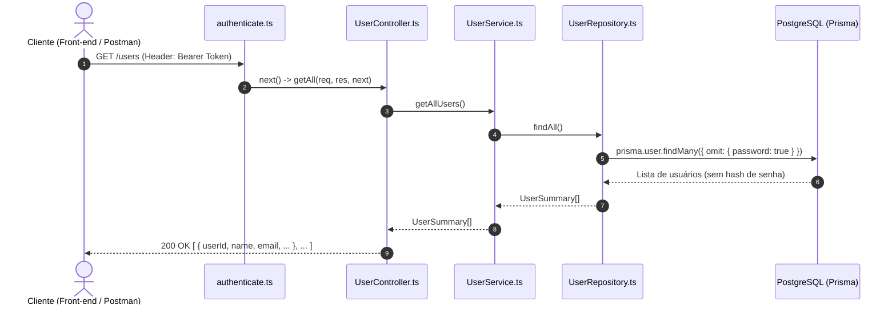
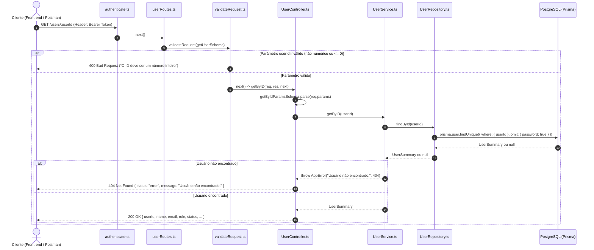
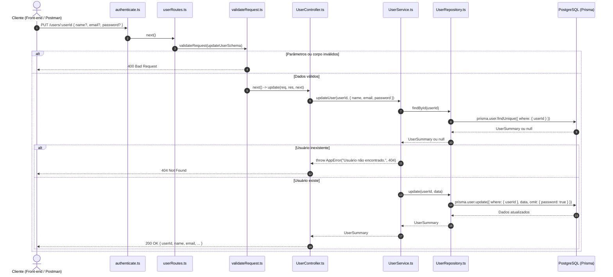
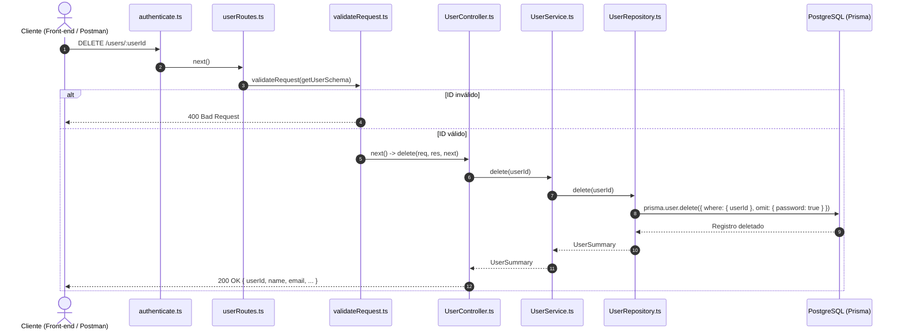

# Fluxo do Módulo de Usuários (CRUD e Regras de Negócio)

Este documento descreve detalhadamente a arquitetura, os fluxos de requisição e as regras de negócio do módulo de **Usuários** (`/users`), cobrindo validação de schemas, controle de acesso, persistência no banco e tratamento de erros.

---

## 1. Visão Geral dos Componentes

| Camada / Arquivo | Responsabilidade |
| :--- | :--- |
| `src/app.ts` | Registra o prefixo `/users`, aplicando o middleware global de autenticação `authenticate` antes de repassar para o roteador. |
| `src/routes/userRoutes.ts` | Declara as rotas de usuários (`POST /`, `GET /`, `GET /:userId`, `PUT /:userId`, `DELETE /:userId`) e vincula os validadores e métodos do controller. |
| `src/middlewares/authenticate.ts` | Valida o JWT (`accessToken`) no cabeçalho `Authorization: Bearer <token>` e injeta `req.user`. |
| `src/middlewares/validateRequest.ts` | Intercepta requisições e valida `body`, `params` e `query` com schemas Zod antes de chegar ao controller. |
| `src/schemas/user.schema.ts` | Define os schemas Zod de criação (`createUserSchema`), atualização (`updateUserSchema`) e consulta (`getUserSchema`). |
| `src/schemas/id.schema.ts` | Valida e faz coerção de parâmetros de identificador (`userId` inteiro e positivo). |
| `src/controllers/UserController.ts` | Extrai os dados da requisição, aciona o `UserService` e retorna os status HTTP apropriados (`200`, `201`). |
| `src/services/UserService.ts` | Implementa regras de negócio: verificação de duplicidade de e-mail, hash de senha (`bcrypt`), checagem de existência e orquestração. |
| `src/repositories/UserRepository.ts` | Interage com o PostgreSQL através do Prisma Client, garantindo a omissão de senhas (`omit: { password: true }`). |
| `src/middlewares/errorHandler.ts` | Captura exceções da aplicação (`AppError`) e retorna respostas JSON padronizadas com status code customizado. |

---

## 2. Fluxo 1: Criação de Usuário (`POST /users`)

Cria um novo usuário no sistema. Valida unicidade de e-mail, aplica hash na senha com bcrypt e persiste os dados com o perfil padrão (`COLABORADOR`) e status `ATIVO`.



### Passo a Passo:
1. **Autenticação:** O middleware `authenticate` verifica a validade do Bearer Token no cabeçalho da requisição.
2. **Validação de Schema:** `validateRequest(createUserSchema)` valida nome (mínimo 3 caracteres), e-mail válido e senha (mínimo 6 caracteres).
3. **Checagem de Duplicidade:** O `UserService` consulta o banco via `UserRepository.findByEmail`. Se já existir, lança erro `400`.
4. **Criptografia da Senha:** A senha plana é convertida em hash seguro utilizando `bcrypt.hash(password, 10)`.
5. **Persistência Segura:** O registro é inserido no banco. O `UserRepository` omite o campo sensível `password` no retorno via configuração Prisma `userSummaryArgs`.
6. **Resposta:** Retorna `201 Created` contendo os dados do usuário cadastrado.

---

## 3. Fluxo 2: Listagem de Usuários (`GET /users`)

Recupera todos os usuários cadastrados na base de dados, omitindo suas senhas.



### Passo a Passo:
1. **Autenticação:** Requisição interceptada e autorizada pelo JWT no `authenticate`.
2. **Execução da Consulta:** O controller aciona `UserService.getAllUsers()`, que invoca `UserRepository.findAll()`.
3. **Filtro de Segurança:** A consulta Prisma aplica `omit: { password: true }` garantindo que nenhuma hash de senha seja trafegada.
4. **Resposta:** Retorna array de `UserSummary` com status `200 OK`.

---

## 4. Fluxo 3: Busca de Usuário por ID (`GET /users/:userId`)

Busca detalhes de um usuário específico a partir do identificador numérico da URL.



### Passo a Passo:
1. **Validação do Parâmetro:** O middleware `validateRequest(getUserSchema)` e `getByIdParamsSchema` validam se `userId` é um número inteiro positivo.
2. **Consulta:** `UserService.getByID` busca o registro pelo ID via `UserRepository.findById`.
3. **Checagem de Existência:**
   - Se o usuário não existir no banco, lança `AppError('Usuário não encontrado.', 404)`.
   - Se existir, retorna os dados com status `200 OK`.

---

## 5. Fluxo 4: Atualização de Usuário (`PUT /users/:userId`)

Atualiza parcialmente ou totalmente os dados de cadastro de um usuário existente (`name`, `email` ou `password`).



### Passo a Passo:
1. **Validação:** Valida o `userId` via `getByIdParamsSchema` e os campos opcionais no corpo (`name`, `email`, `password`) via `updateUserSchema`.
2. **Verificação Prévia:** O serviço consulta se o registro existe no banco antes de tentar executar o update.
3. **Atualização no Banco:** Executa `prisma.user.update` persistindo as alterações e omitindo a senha na resposta.
4. **Resposta:** Retorna `200 OK` com os dados atualizados do usuário.

---

## 6. Fluxo 5: Remoção de Usuário (`DELETE /users/:userId`)

Exclui o registro de um usuário da base de dados.



### Passo a Passo:
1. **Validação de ID:** Valida o parâmetro `userId` da rota.
2. **Exclusão:** Executa o delete no banco de dados via `prisma.user.delete`.
3. **Resposta:** Devolve o resumo do usuário excluído com status `200 OK`.

---

## 7. Estruturas e Modelagem de Dados

### Modelo no Banco de Dados (`prisma/models/user.prisma`)
```prisma
enum Role {
  ADMIN
  COLABORADOR
}

enum Status {
  ATIVO
  INATIVO
}

model User {
  userId       Int      @id @default(autoincrement())
  email        String   @unique
  name         String?
  password     String
  refreshToken String?
  role         Role     @default(COLABORADOR)
  status       Status   @default(ATIVO)
  createdAt    DateTime @default(now())
  updatedAt    DateTime @updatedAt

  @@map("users")
}
```

### Contrato de Retorno Seguro (`UserSummary`)
No `UserRepository.ts`, todas as consultas aplicam a seguinte omissão:
```typescript
const userSummaryArgs = {
  omit: { password: true }
} satisfies Prisma.UserFindManyArgs;

export type UserSummary = Prisma.UserGetPayload<typeof userSummaryArgs>;
```
Isso assegura em tempo de compilação e execução que a hash da senha nunca seja exposta acidentalmente nas respostas das rotas de usuários.

---

## 8. Tratamento de Erros e Códigos de Status HTTP

| Código | Situação | Exemplo de Mensagem |
| :--- | :--- | :--- |
| `200 OK` | Consulta, atualização ou remoção executada com sucesso. | Objeto `UserSummary` ou lista. |
| `201 Created` | Usuário registrado com sucesso. | Objeto `UserSummary` recém-criado. |
| `400 Bad Request` | Falha na validação de dados de entrada Zod ou regra de e-mail duplicado. | `"Este e-mail ja esta em uso."` ou lista de erros de schema. |
| `401 Unauthorized` | Token de autenticação ausente, corrompido ou expirado. | `"Token missing"` / `"Token expired"` / `"Invalid token"`. |
| `404 Not Found` | O `userId` informado não corresponde a nenhum registro existente. | `"Usuário não encontrado."` |
| `500 Internal Server Error` | Erros inesperados de infraestrutura ou banco de dados. | `"Internal Server Error"`. |

---

## 9. Boas Práticas Adotadas

* **Proteção Global da Rota:** Todas as rotas filhas de `/users` são protegidas pelo middleware `authenticate` em `app.ts`.
* **Validação de Entrada com Zod:** Parâmetros de rota (`params`) e corpo (`body`) são rigorosamente validados e tipados antes de qualquer operação de banco.
* **Segurança de Senhas:** Criptografia irreversível com `bcrypt` (10 rounds de salt) no cadastro.
* **Prevenção de Vazamento de Credenciais:** Assegurada no nível da camada de repositório (`omit: { password: true }`), tornando impossível o retorno da senha para as camadas superiores.
* **Arquitetura em Camadas (Separation of Concerns):** Roteamento, validação, controle de requisição, regras de negócio e acesso ao banco são desacoplados em classes e módulos com responsabilidade única.
